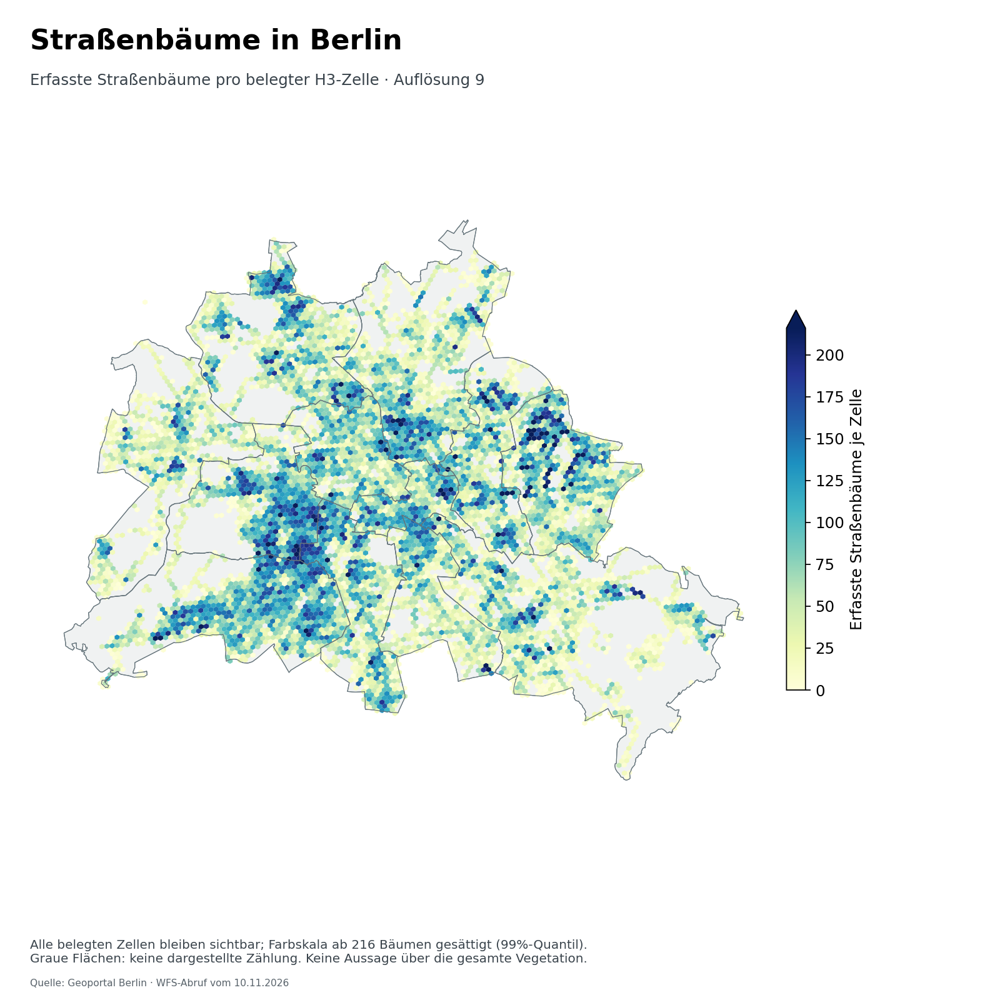
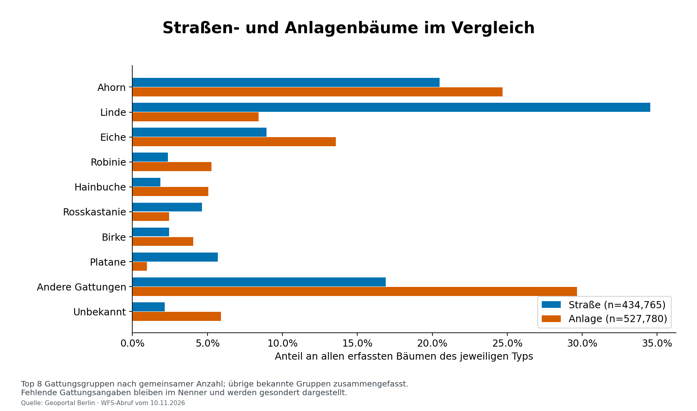
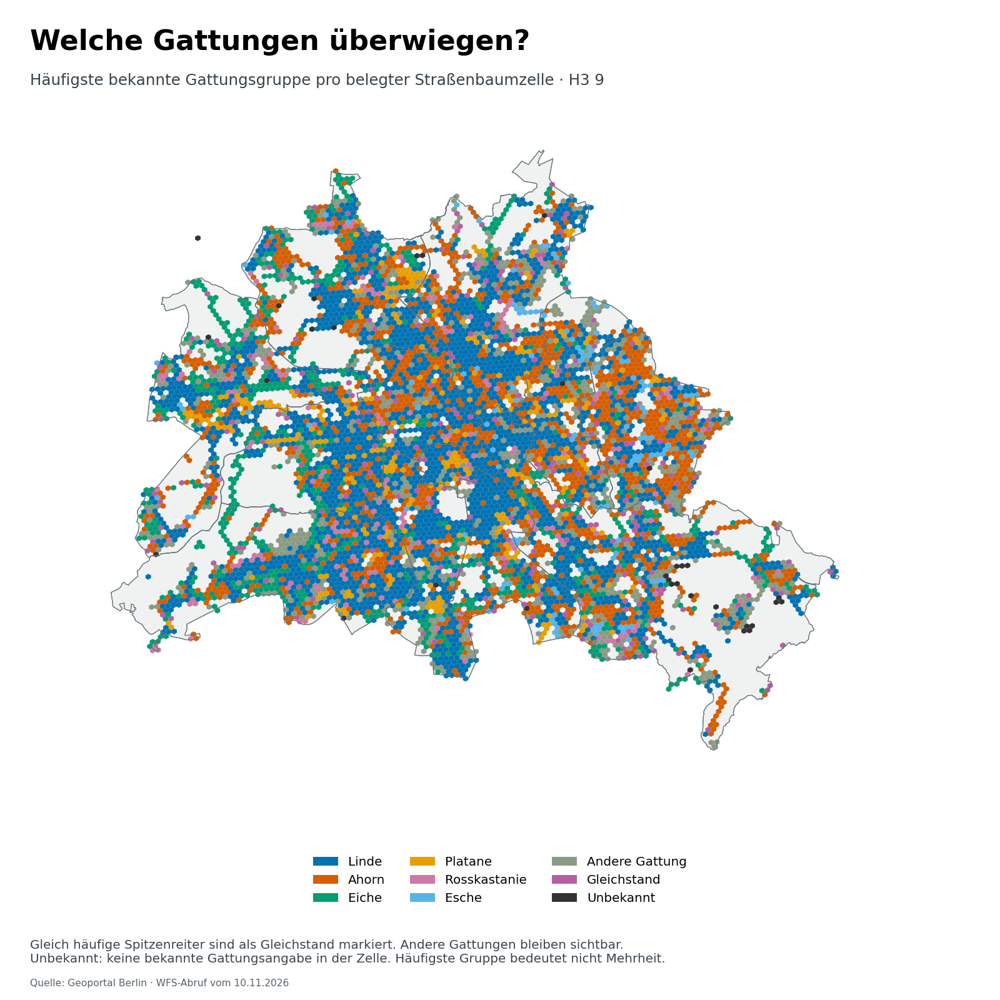
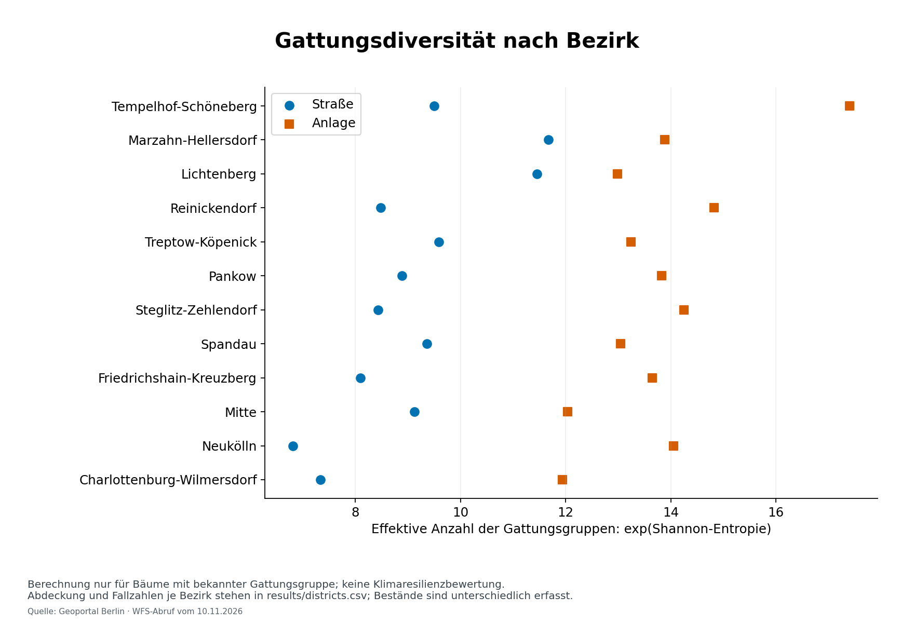
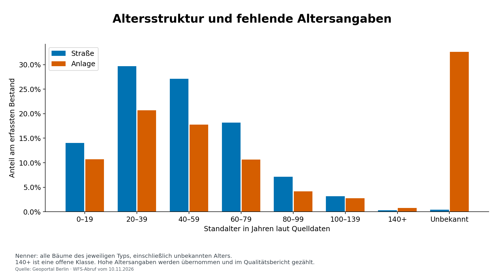

# Baumbestand Berlin

**Zusammensetzung, Altersstruktur und räumliche Verteilung der erfassten Straßen- und Anlagenbäume Berlins.**

Das Projekt verbindet offene Katasterdaten mit einer nachvollziehbaren Python-Analyse: Wie unterscheiden sich Straßen- und Anlagenbäume? Wie vielfältig sind die erfassten Gattungsgruppen innerhalb der Bezirke? Wo konzentrieren sich erfasste Straßenbäume, und welche Gattungsgruppen sind dort am häufigsten?



Die Karte zeigt absolute Bestandszahlen pro belegter Hexagonzelle. Besonders hohe Werte bleiben vollständig enthalten; lediglich die Farbskala sättigt am 99%-Quantil. Ungefärbte Gebiete sind kein Nachweis fehlender Vegetation.

## Ergebnisse

Grundlage der enthaltenen Tabellen und Grafiken ist der **WFS-Abruf vom 10. November 2026** mit **962.545 Datensätzen**. Das Abrufdatum ist nicht gleichbedeutend mit einem gemeinsamen Erhebungsdatum aller Bäume.

| Bestand | Datensätze | Gattung unbekannt | Alter fehlend oder ungültig |
|---|---:|---:|---:|
| Straße | 434.765 | 2,2 % | 0,4 % |
| Anlage | 527.780 | 5,9 % | 32,6 % |

- **Linde** ist mit **150.148 Einträgen (34,5 %)** die häufigste erfasste Gattungsgruppe unter den Straßenbäumen. Der Prozentwert bezieht sich auf alle Straßenbaum-Datensätze einschließlich unbekannter Gattungen.
- Die Altersdaten sind unterschiedlich vollständig: Bei Anlagenbäumen fehlen erheblich häufiger verwertbare Altersangaben als bei Straßenbäumen. Direkte Altersvergleiche müssen diese Lücke berücksichtigen.
- Die räumlichen Karten betreffen ausschließlich Straßenbäume. Anlagenbäume gehen separat in Bestands-, Alters- und Diversitätsvergleiche ein.

### Zusammensetzung



Die acht insgesamt häufigsten bekannten Gattungsgruppen werden einzeln gezeigt. Weitere bekannte Gruppen und fehlende Angaben haben eigene Kategorien. Dadurch bleibt die vollständige Zählgrundlage sichtbar.

### Räumlich häufigste Gattungsgruppe



Die Farbe bezeichnet den häufigsten bekannten Eintrag in einer Zelle. Sie bedeutet nicht zwangsläufig einen Anteil über 50 %. Gleichstände werden separat markiert; seltenere Gattungen bleiben als eigene Sammelkategorie sichtbar. Die genauen Spitzenanteile und Fallzahlen stehen in [street_hexagons.csv](results/street_hexagons.csv).

### Diversität und Alter





Die vollständigen aggregierten Ergebnisse stehen unter [results](results/). Das [Ergebnisnotebook](notebooks/BaumbestandBerlin.ipynb) erschließt dieselben Tabellen und Grafiken ohne erneuten Rohdatendownload.

## Daten und Methoden

**Quellen.** Straßen- und Anlagenbäume stammen aus dem Berliner Grünflächeninformations- und -managementsystem; Bezirksgrenzen aus ALKIS Berlin. Die Baumdaten umfassen Straßenbäume und einen Teil der Anlagenbäume, nicht die gesamte Berliner Vegetation. [Datensatz Baumbestand](https://daten.berlin.de/datensaetze/baumbestand-berlin-wfs-48ad3a23) · [Datensatz Bezirke](https://daten.berlin.de/datensaetze/alkis-berlin-bezirke-wfs-ced31d7d)

**Download.** WFS 2.0, nach stabilen Schlüsseln sortierte Seiten, Prüfung der Feature-IDs und der gemeldeten Gesamtzahl vor, während und nach dem Abruf. Wiederholte Seiten, unerwartete Feldausfälle oder widersprüchliche Gesamtzahlen führen zum Abbruch. Eine neue Datendatei ersetzt den Cache erst nach erfolgreicher Prüfung. Ein SHA-256-Wert und Abrufmetadaten dokumentieren jede Quelle. Das schützt vor offensichtlicher Unvollständigkeit; ein sich während des Abrufs inhaltlich ändernder Dienst ist damit kein transaktionaler Datenbanksnapshot.

**Zählgrundlage.** Jede Zeile zählt einmal innerhalb ihres Quelllayers. Die beiden Layer werden getrennt ausgewertet; eine layerübergreifende Identitätsprüfung findet nicht statt. Unbekannte Gattungen und Bezirke werden ausdrücklich mitgezählt. Fehlende Einzelmerkmale führen nicht zum Verlust ganzer Datensätze. Die Gattungsgruppen entsprechen den normalisierten Bezeichnungen in `gattung_deutsch`; sie sind keine nachträglich taxonomisch validierte Artenliste.

**Diversität.** Für jeden Bezirk und Bestandstyp werden bekannte Gattungsgruppen mit ihren Häufigkeiten ausgewertet:

$$H=-\sum_i p_i\ln(p_i),\qquad D=\exp(H).$$

`D` ist die effektive Anzahl gleich häufiger Gattungsgruppen. Fehlende Gattungen werden aus dieser Berechnung ausgeschlossen; ihr Anteil bleibt in den Ergebnistabellen sichtbar. Eine einzelne bekannte Gruppe ergibt `D = 1`. Die Kennzahl beschreibt die Zusammensetzung des erfassten Bestands und ist keine Bewertung der Klimaresilienz. Unterschiedliche Erfassung und Stichprobengrößen schränken Bezirksvergleiche ein.

**Alter.** Verwendet wird `standalter` aus dem Kataster, ohne Neuberechnung anhand des heutigen Jahres. Fehlende, nichtnumerische und negative Werte werden als unbekannt gezählt. Die letzte Altersklasse ist nach oben offen. Auffällig hohe Angaben über 200 Jahre bleiben erhalten und werden im Qualitätsbericht gesondert gezählt; sie sind damit nicht als biologisch validiert anzusehen.

**Räumliche Aggregation.** H3-Auflösung 9; jede gültige Straßenbaum-Punktgeometrie wird genau einer Zelle zugeordnet. Karten und Flächenberechnungen verwenden EPSG:25833, die H3-Zuordnung WGS84. Die Hauptkarte zeigt Anzahl pro Zelle, keine Versorgungsquote. Die zusätzliche Tabellenkennzahl pro km² verwendet die gesamte Hexagonfläche einschließlich gegebenenfalls außerhalb Berlins liegender Anteile. Zellen werden nicht an Bezirksgrenzen abgeschnitten. Punkte außerhalb der Bezirksumrisse werden gezählt und nicht stillschweigend entfernt.

**Qualität.** [summary.json](results/summary.json) enthält Herkunft, Prüfsummen, Fehlwerte, auffällige Alterswerte und Geometrieprüfungen. Der aktuelle Lauf enthält **73 Straßenbaum-Punkte außerhalb der verwendeten Berliner Bezirksumrisse**. Tabellen enthalten auch Datensätze mit unbekanntem Bezirk; die Bezirksgrafik zeigt nur benannte Bezirke. Die Ergebnisse sind deskriptiv und erlauben keine Aussagen über einzelne Standortbedingungen, Baumgesundheit oder unzureichende Versorgung.

## Reproduktion

Python **3.12**. Im Projektverzeichnis:

```bash
python -m pip install -r requirements.txt
python -m berlin_trees download
python -m berlin_trees analyze --snapshot-label "WFS-Abruf; Datum siehe Quellenmanifest"
```

`download` legt die reduzierten Quelldaten unter `data/raw/` ab. Verifizierte vorhandene Downloads werden wiederverwendet; `--refresh` fordert einen neuen Abruf an. Die Rohdaten sind über `.gitignore` von Git ausgeschlossen. `analyze` erzeugt die fünf Abbildungen und die Ergebnistabellen neu. Ein späterer WFS-Abruf kann abweichende Ergebnisse liefern, weil die Quelle fortgeschrieben wird. Die im Repository enthaltenen Ergebnisse dokumentieren den oben genannten Abruf.

Beide Befehle unterstützen `--data-dir`. Bei der Analyse sind außerdem `--output-dir`, `--figure-dir` und `--resolution` konfigurierbar. Vollständige Optionen:

```bash
python -m berlin_trees download --help
python -m berlin_trees analyze --help
```

Das Ergebnisnotebook benötigt zusätzlich Jupyter, wenn es lokal ausgeführt werden soll:

```bash
python -m pip install jupyterlab
python -m jupyterlab notebooks/BaumbestandBerlin.ipynb
```

## Projektstruktur

```text
berlin_trees/   Datenabruf, Bereinigung, Analyse und Visualisierung
notebooks/     Ergebnisnotebook
tests/         Synthetische Tests, ohne Netzwerkzugriff
data/          Datenbeschreibung; Rohdaten werden lokal heruntergeladen
results/       Aggregierte Tabellen und Quellen-/Qualitätsmanifest
figures/       Fünf reproduzierbare Ergebnisgrafiken
```

## Tests

```bash
python -m unittest discover -s tests -v
```

Die Tests prüfen Zählerhaltung, fehlende Angaben, Diversitätsreferenzfälle, H3-Zuordnung und Gleichstände sowie paginierte Downloads, Cache-Prüfsummen und den Schutz bestehender Dateien bei fehlerhaften Antworten. Der GitHub-Actions-Workflow führt sie mit Python 3.12 aus, ohne die WFS-Dienste zu belasten.

## Autor und Lizenz

Peter Keller. Code: [MIT-Lizenz](LICENSE). Die amtlichen Quelldaten stehen laut den verlinkten Datensatzbeschreibungen unter [Datenlizenz Deutschland – Zero – Version 2.0](https://www.govdata.de/dl-de/zero-2-0). Ihre Lizenz ist von der Code-Lizenz unabhängig. Die publizierten Tabellen und Visualisierungen wurden aus diesen Quellen erzeugt; Quellenangaben sind in den Abbildungen und im Manifest enthalten.
